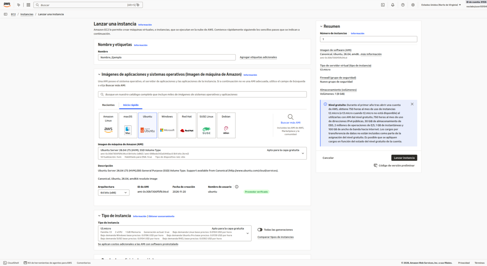
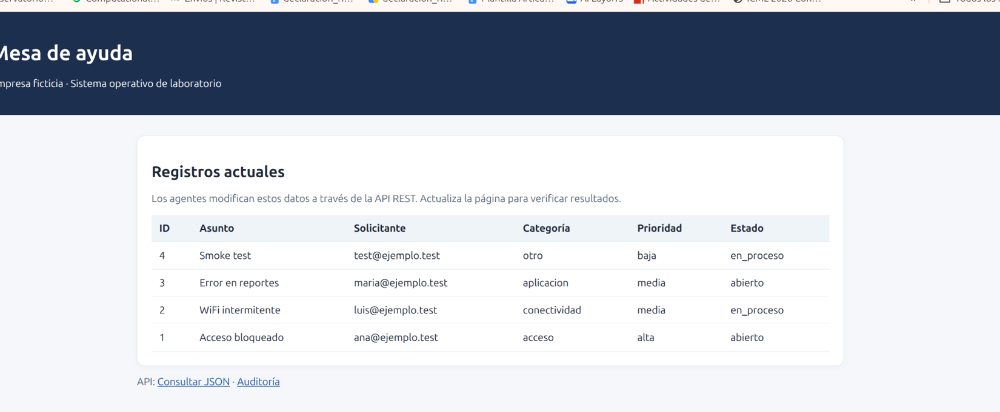
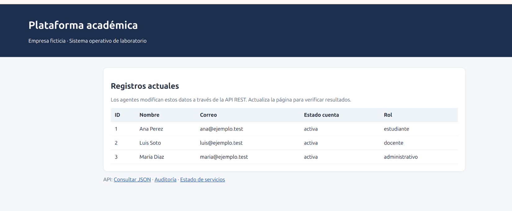
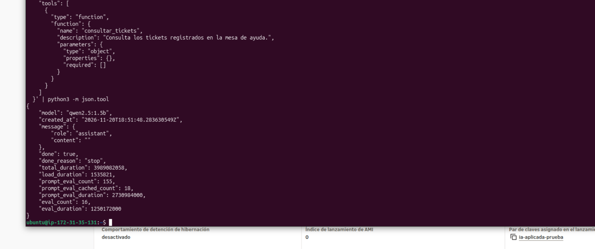
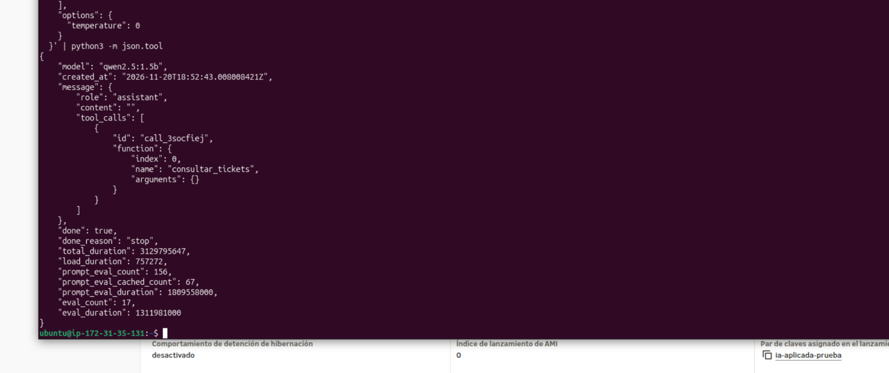
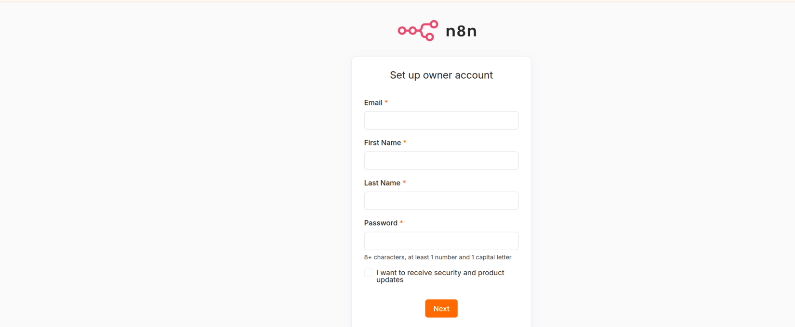
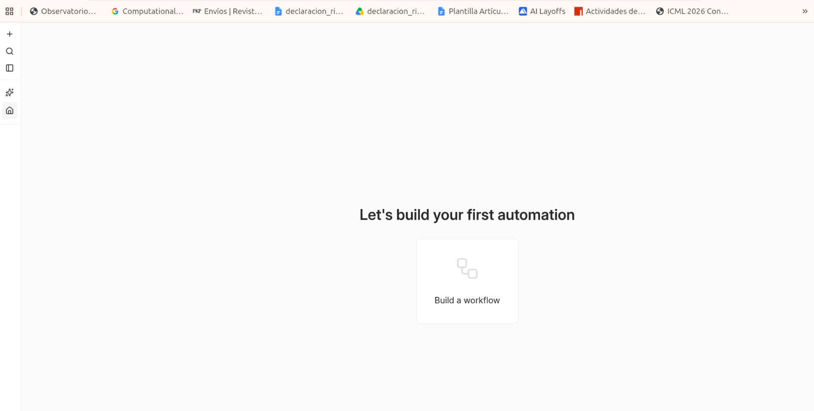
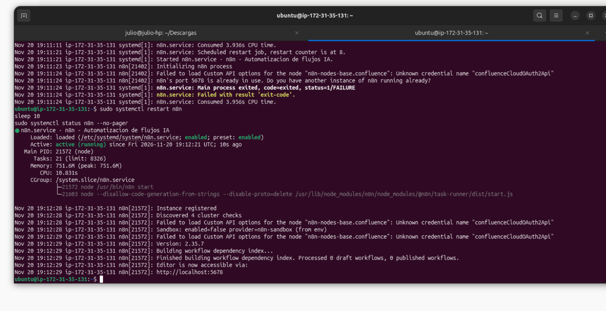

# Anexo visual de Semana 0

Estas capturas son referencias de las pruebas docentes, no reemplazan las instrucciones de la [guía autónoma](../guia-paso-a-paso.md).

## Paso 1: Instancia EC2 en AWS

Vista de referencia de la consola EC2. Comprueba el estado de la instancia, su tipo y los datos de configuración.

## Paso 7: Mesa de ayuda

Interfaz del sistema de tickets. Se abre en http://localhost:8081 mediante túnel SSH.

## Paso 7: Sistema académico

Interfaz de cuentas y servicios ficticios. Se abre en http://localhost:8082 mediante túnel SSH.

## Paso 8: Ollama

Verificación del modelo local y sus capacidades. El modelo debe responder antes de continuar.

## Paso 8: Selección de herramienta

Ejemplo de respuesta de la API de Ollama. Seleccionar una herramienta no ejecuta todavía la API empresarial.

## Paso 10: Registro inicial de n8n

Pantalla de creación de la cuenta propietaria. Usa una contraseña exclusiva y no la compartas.

## Paso 10: Editor de n8n

Vista inicial del editor de workflows accesible mediante http://localhost:5678.

## Paso 11: Servicio n8n activo

Estado de systemd tras resolver el conflicto del puerto 5678: active (running).

